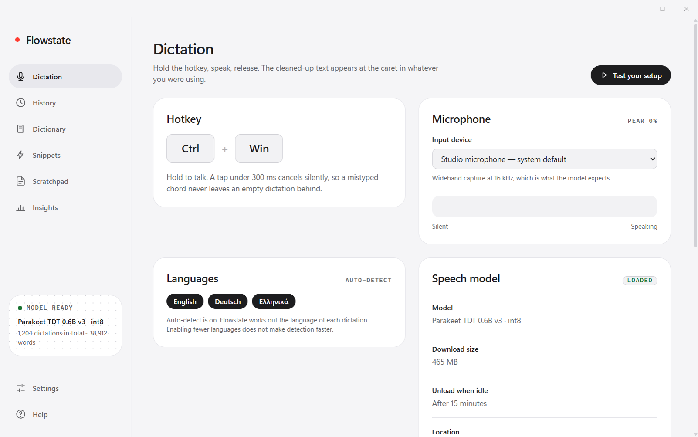
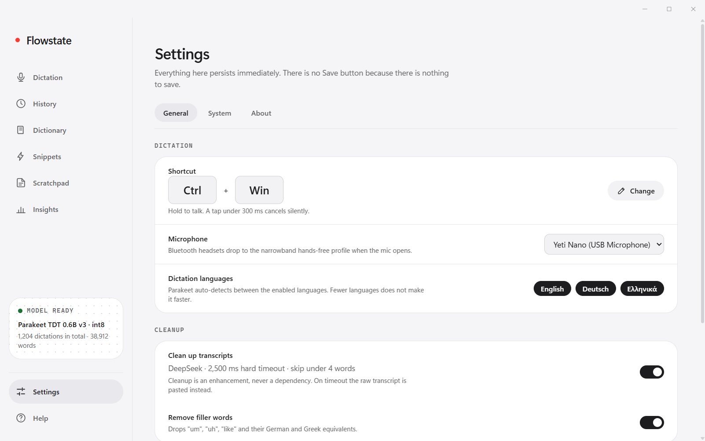

# Flowstate

**Hold a key, say it, let go. Clean text appears wherever your cursor is.**

Flowstate is a free, open-source voice dictation app for Windows, an open-source alternative to Wispr Flow. Speech is recognised on your own PC. There is no account, no subscription and no word limit.

<p align="center">
  <a href="https://github.com/Suma-Udd/flowstate/releases/latest/download/Flowstate-Setup.exe"><b>Download Flowstate-Setup.exe</b></a>
  <br>
  <sub>Windows 10 or 11, 64-bit. About 110 MB, plus a 490 MB speech model on first run.</sub>
</p>

<p align="center">
  <picture>
    <source media="(prefers-color-scheme: dark)" srcset="docs/screenshots/dictation-dark.png">
    
  </picture>
</p>

## Install

1. **Download** [Flowstate-Setup.exe](https://github.com/Suma-Udd/flowstate/releases/latest/download/Flowstate-Setup.exe) and run it.
2. Windows may say "Windows protected your PC", because the installer is not code-signed yet. Click **More info**, then **Run anyway**.
3. Follow the short setup: it downloads the speech model, checks your microphone and shows you the shortcut.

That is all. Flowstate lives in the system tray and starts with Windows (you can turn that off).

## Use it

Click in any text field, in any app. **Hold Ctrl + Win**, speak, then **let go**. Your words are pasted at the cursor, with punctuation and capital letters, in about a second or two.

- A quick tap on the keys does nothing, so you never paste by accident.
- You can change the shortcut in Settings, or in the setup.
- **Dictionary**: teach it names and jargon it should always spell right.
- **Snippets**: say a trigger phrase and get a longer text, such as an email signature.
- **History**: every dictation is searchable and can be pasted again.
- **Scratchpad**: a small notepad that you can dictate straight into.
- **Insights**: your speed and habits, counted on your PC and nowhere else.

<p align="center">
  <picture>
    <source media="(prefers-color-scheme: dark)" srcset="docs/screenshots/settings-dark.png">
    
  </picture>
</p>

## Cleanup (optional)

By default Flowstate pastes exactly what it heard. For better punctuation, casing and no "um" or "uh", add a key for any service that speaks the OpenAI chat format. Pick a provider in **Settings, General** or in the first-run setup, paste a key, press **Test**.

| Provider | Where to get a key |
|---|---|
| DeepSeek (default) | platform.deepseek.com |
| OpenAI | platform.openai.com |
| Groq | console.groq.com |
| OpenRouter | openrouter.ai |
| Custom | any OpenAI-compatible server, such as a local Ollama or LM Studio |

Cleanup is a short edit of your own words, so it costs a fraction of a cent per dictation. It can never answer or add content: Flowstate checks that the result is an edit of what you said and pastes your original words if it is not. With no key, or if the service is slow or down, you get the raw transcript.

## Languages

The speech model, NVIDIA Parakeet TDT 0.6B v3, transcribes 25 European languages and works out which one you are speaking: Bulgarian, Croatian, Czech, Danish, Dutch, English, Estonian, Finnish, French, German, Greek, Hungarian, Italian, Latvian, Lithuanian, Maltese, Polish, Portuguese, Romanian, Russian, Slovak, Slovenian, Spanish, Swedish and Ukrainian.

Be honest about the limits:

- **English and German** are the best supported. Cleanup, the language guess and the tests are built around them.
- **Greek** is supported but weak. Expect mistakes.
- **Other languages** are transcribed by the model, but cleanup is not tuned for them, so you get the raw transcript.
- Very quiet speech and whispering are not handled well, and the model runs on the CPU, so a long dictation takes a moment to appear after you let go.

## Privacy

- **Your voice never leaves your PC.** Audio is recognised locally and is not saved.
- **Text goes out only if you add a cleanup key**, and only to the provider you chose. Only the text of that one dictation is sent, never audio, and never your history.
- Your API key is stored only in `%APPDATA%\flowstate\config.json` on your PC.
- Your history, dictionary and snippets stay in `%APPDATA%\flowstate`.
- Flowstate has no analytics and no telemetry. The only other network use is downloading the speech model once from the sherpa-onnx project on GitHub, and asking GitHub whether a newer Flowstate exists.
- To notice the shortcut, Flowstate listens to the keyboard for the hold-to-talk keys. It does not record what you type.

## Updates

Flowstate checks GitHub for a new version shortly after it starts and every few hours. When there is one, a card appears with what changed. **Update and restart** downloads the installer, verifies it, installs it quietly and starts Flowstate again. **Later** hides it. You can also press **Check for updates** in Settings, About.

Updates are verified two ways before anything runs: a SHA-256 checksum and an Ed25519 signature that only the maintainer can make. See [SECURITY.md](SECURITY.md).

## Troubleshooting

**Windows says "protected your PC" when I run the installer.** The installer is not code-signed yet, which costs money. Click **More info**, then **Run anyway**.

**Nothing is pasted.** Flowstate pastes with Ctrl+V into the window that was in front. Windows does not let a normal app paste into an app running as administrator. Run the other app normally, or Flowstate as administrator. When a paste cannot land, your text stays on the clipboard.

**"Microphone permission was denied".** Open Windows Settings, Privacy and security, Microphone, and allow microphone access for desktop apps.

**The shortcut does nothing, or Windows reacts to it.** Another program may use the same keys. Pick a different shortcut in Settings, General, **Change**.

**The first run is stuck downloading.** The model is about 490 MB. If it fails, press **Try again** in the setup or **Re-download** on the Dictation screen. A firewall or a proxy that blocks github.com will stop it.

**Antivirus complains.** Flowstate uses a global keyboard hook to detect the shortcut, which some antivirus tools flag. The code is all in this repository.

**Where are the logs?** `%APPDATA%\flowstate\logs`. **Settings, About** has Copy diagnostics, which never includes your key.

**Start fresh.** Quit Flowstate and delete `%APPDATA%\flowstate`. The speech model lives in `%LOCALAPPDATA%\flowstate\models`.

Still stuck? [Open an issue](https://github.com/Suma-Udd/flowstate/issues).

## Build from source

Windows only. You need Node.js 24 or newer and git.

```
git clone https://github.com/Suma-Udd/flowstate.git
cd flowstate
npm ci
npm start
```

| Command | What it does |
|---|---|
| `npm test` | runs the whole test suite |
| `npm run dist` | builds `release\Flowstate-Setup.exe` |
| `npm run screenshots` | regenerates the pictures in this README |

While developing, set `FLOWSTATE_DATA_DIR` to an empty folder to give the dev app its own settings, history and lock, so it does not touch an installed Flowstate.

See [CONTRIBUTING.md](CONTRIBUTING.md) for how the code is organised and what a good change looks like.

## How it works

Hold the keys and the microphone opens. When you let go, a voice-activity detector trims the silence, the Parakeet model turns speech into text, and your dictionary and snippets are applied. If you set a cleanup key, a small language model tidies the text, and a guard rejects anything that is not an edit of what you said. The result is pasted with a simulated Ctrl+V and your clipboard is restored.

Electron app, plain JavaScript, no bundler. Speech recognition runs through sherpa-onnx in a background process that unloads when you have not dictated for a while, so Flowstate is light when idle.

## License

MIT. See [LICENSE](LICENSE). Third-party software and the speech model have their own licenses: see [THIRD_PARTY_NOTICES.md](THIRD_PARTY_NOTICES.md).

Made by [Sumayer](https://github.com/Suma-Udd).
